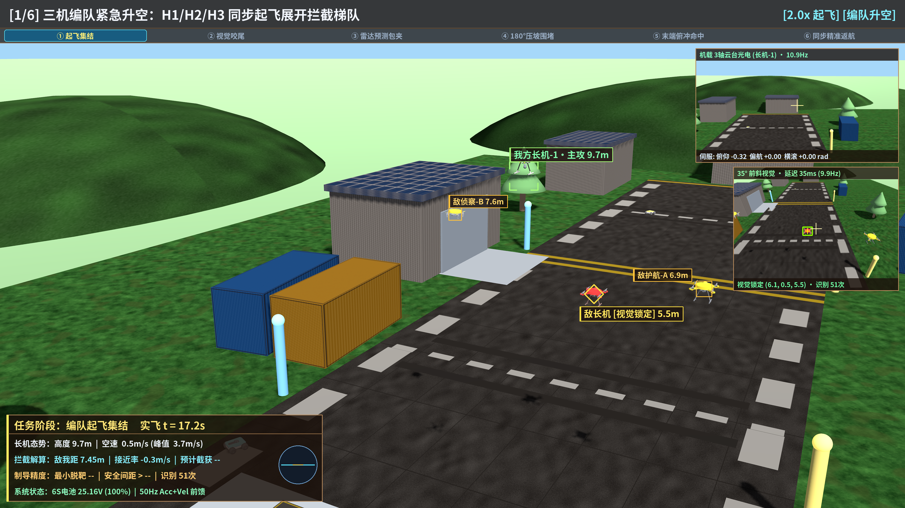
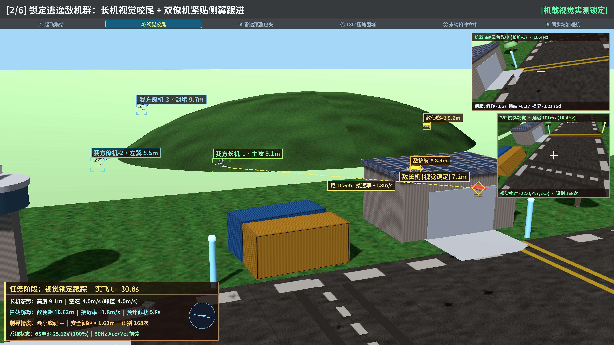
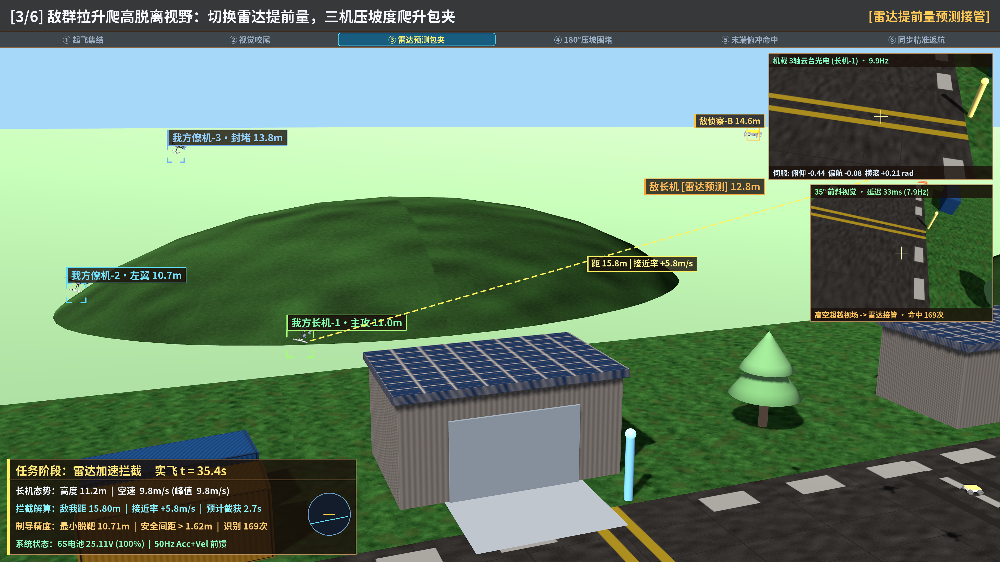
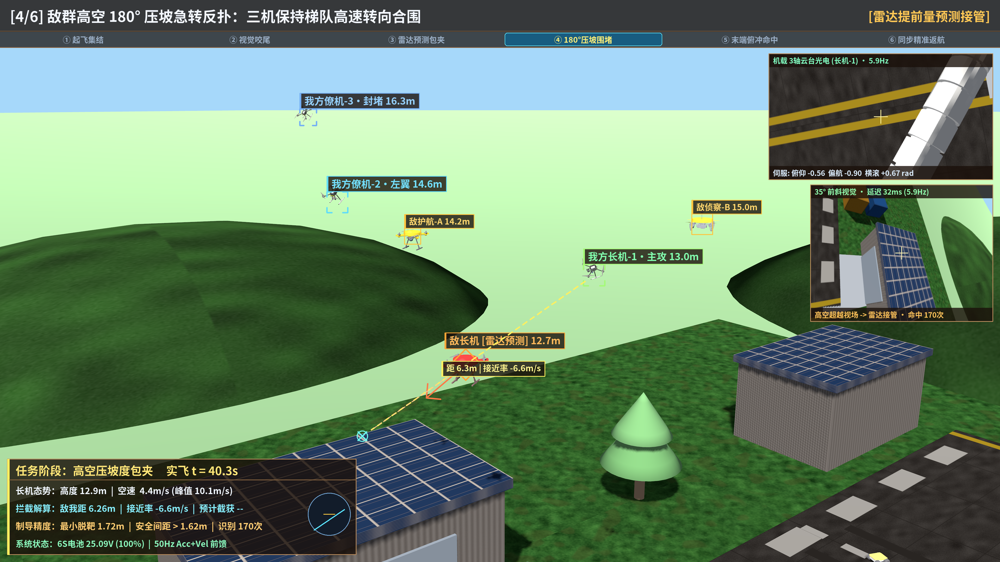
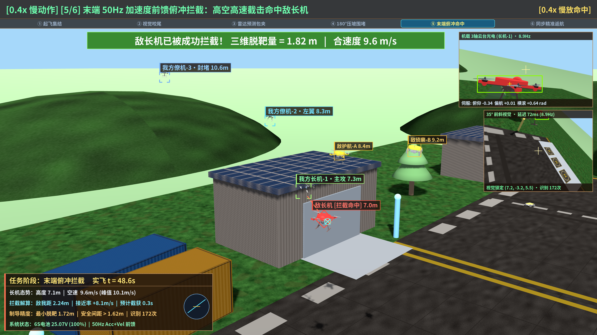
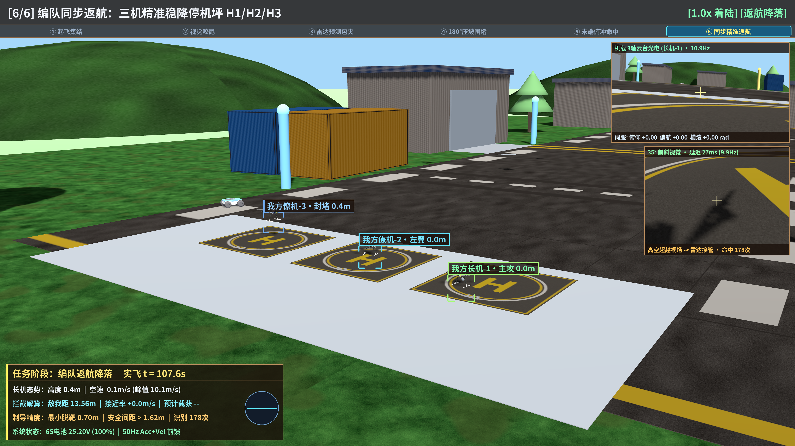

# 课题二飞控仿真演进展示存档 (`archive/flight-ctrl-demos`)

> **分支隔离说明**：本分支为**独立纯视频展示存档分支**（基于 `--orphan` 创建，不含队友代码，也**不合并入 `main`**），避免将大型 `.mp4` 二进制记录带入主开发分支影响团队 `git clone` 速度。
> 飞控功能包源码、`README.md` 与 `launch` 配置位于独立开发分支 `feat/flight-ctrl-pkg` 的 `src/flight_ctrl_pkg/` 目录。

---

## 一、全 6 轮演示视频清单（均已控制在 GitHub 单文件限制内）

| 轮次 | 视频文件 | 分辨率 / 帧率 | 时长 | 文件大小 | 核心演进内容 |
|:---|:---|:---|:---|:---|:---|
| 第 1 轮 | [`round1_basic_closed_loop_720p.mp4`](flight_ctrl_demos/videos/round1_basic_closed_loop_720p.mp4) | `1280×720 @ 10fps` | `63.00s` | `1.3 MiB` | 单机起飞 -> 视觉锁敌 -> 攻击 -> 返航基础闭环验证 |
| 第 2 轮 | [`round2_chase_cam_720p.mp4`](flight_ctrl_demos/videos/round2_chase_cam_720p.mp4) | `1280×720 @ 10fps` | `57.90s` | `1.9 MiB` | 新增第三人称跟拍视角、基础 HUD 遥测卡片 |
| 第 3 轮 | [`round3_pbr_offboard_900p.mp4`](flight_ctrl_demos/videos/round3_pbr_offboard_900p.mp4) | `1600×900 @ 25fps` | `31.48s` | `7.5 MiB` | 户外 PBR 机场场馆渲染与 50 Hz Offboard 流畅提速 |
| 第 4 轮 | [`round4_high_agility_x8_4k.mp4`](flight_ctrl_demos/videos/round4_high_agility_x8_4k.mp4) | `3840×2160 @ 25fps` | `47.84s` | `82.8 MiB` | 原生 4K 画质 + 红翼 Skywalker X8 靶机高机动拦截 |
| 第 5 轮 | [`round5_swarm_showdown_2k_web.mp4`](flight_ctrl_demos/videos/round5_swarm_showdown_2k_web.mp4) | `2560×1440 @ 25fps` | `88.84s` | `64.7 MiB` | 3v1 集群协同包夹与三机专属停机坪返航（由原 `178M` 4K 版两遍转码至 `< 80 MB`） |
| 第 6 轮（终版） | [`round6_cinema_3v3_dogfight_4k_web.mp4`](flight_ctrl_demos/videos/round6_cinema_3v3_dogfight_4k_web.mp4) | `3840×2160 @ 30fps` | `46.63s` | `64.6 MiB` | 3v3 异构多旋翼高空压坡度对抗、`50Hz SE(3)` 无抖动运镜、2K 分块场景、座舱级大字 HUD 与 `IP/Vc/TTI` 拦截解算（由原 `394M` 4K 版两遍转码至 `< 80 MB`） |

---

## 二、终版（第 6 轮）关键验证指标

- **全链路闭环**：联合未修改源码的 `center_node_pkg` 与 `vision_pkg` 运行，实测视觉检测 `vis=178` 次，PX4 原生三轴云台伺服全程跟踪峰值 `servo_max={0: 1.0, 1: 1.0, 2: 1.0}`。
- **集群敏捷机动与安全性**：编队空中最小三维间距 `min_sep=1.62m`，长机拦截峰值速度 `peak_att=9.80m/s`（全程峰值 `peak_overall=10.12m/s`），末端俯冲最小三维脱靶量 `attack_min_miss=0.70m`，三机精准降落于 `H1/H2/H3` 停机坪。

---

## 三、终版关键帧图集（第 6 轮 `sim_cinema_4k`）

| 阶段 | 关键帧预览 |
|:---|:---|
| 1/6 三机紧急升空 |  |
| 2/6 视觉咬尾追击 |  |
| 3/6 高空雷达预测接管 |  |
| 4/6 高空 180° 压坡对抗 |  |
| 5/6 0.4x 慢动作末端命中 |  |
| 6/6 三机同步精准返航 |  |

其余第 1～5 轮阶段截图同样归档于 [`flight_ctrl_demos/screenshots/round1`](flight_ctrl_demos/screenshots/round1) 至 [`round5`](flight_ctrl_demos/screenshots/round5)。
