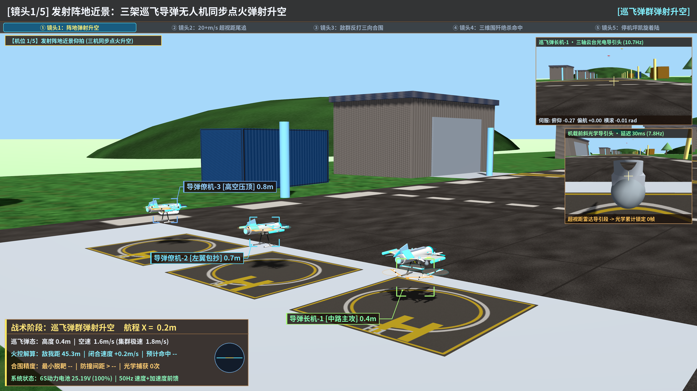
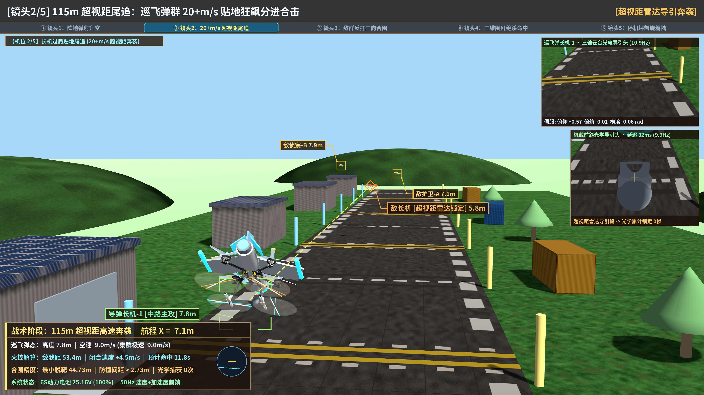
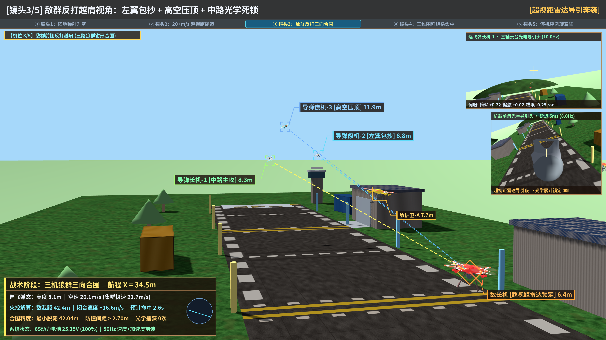
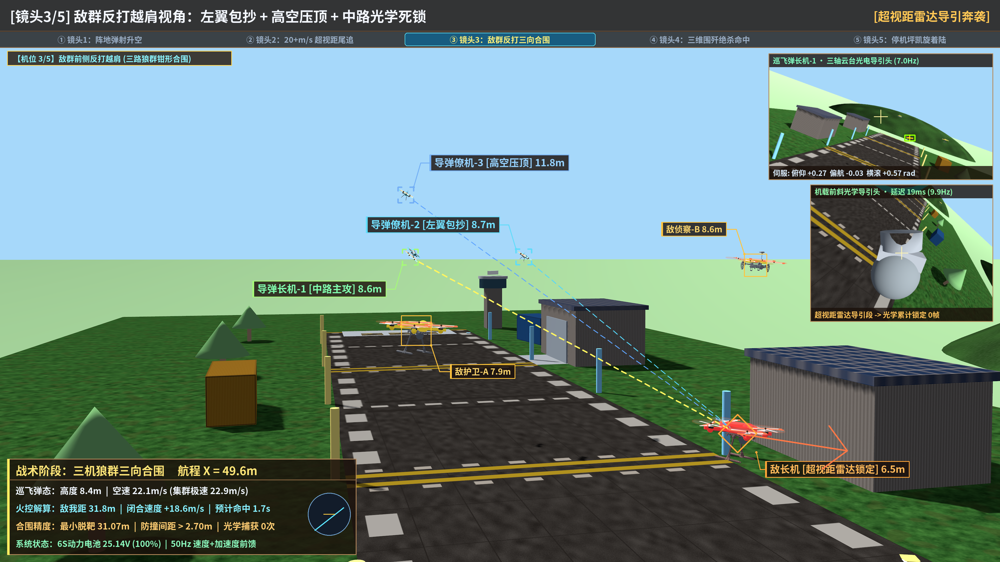
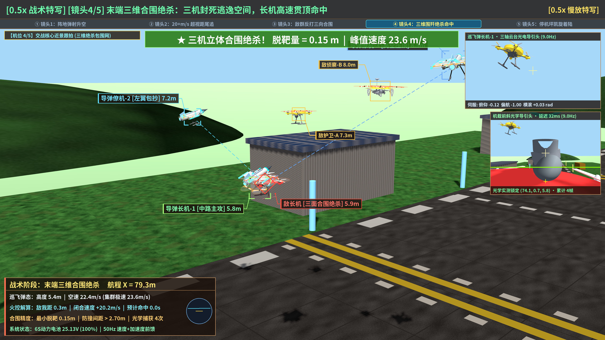
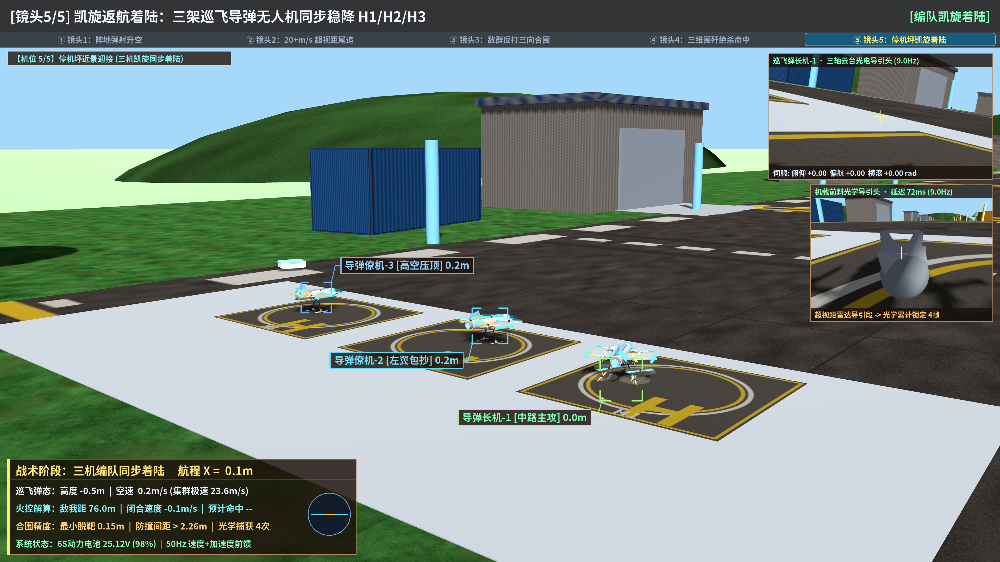

# 课题二飞控仿真演进展示存档 (`archive/flight-ctrl-demos`)

> **分支隔离说明**：本分支为**独立纯视频展示存档分支**（基于 `--orphan` 创建，不含任何队友工程代码，也**不合并入 `main`**），避免将大型 `.mp4` 二进制记录带入主开发分支影响团队 `git clone` 速度。
> 飞控功能包源码、`README.md` 与 `launch` 配置位于独立开发分支 `feat/flight-ctrl-pkg` 的 `src/flight_ctrl_pkg/` 目录。

---

## 一、全 7 轮演示视频清单（均已控制在 GitHub 100MB 单文件限制内）

| 轮次 | 视频文件 | 分辨率 / 帧率 | 时长 | 文件大小 | 核心演进内容 |
|:---|:---|:---|:---|:---|:---|
| 第 1 轮 | [`round1_basic_closed_loop_720p.mp4`](flight_ctrl_demos/videos/round1_basic_closed_loop_720p.mp4) | `1280×720 @ 10fps` | `63.00s` | `1.3 MiB` | 单机起飞 -> 视觉锁敌 -> 攻击 -> 返航基础闭环验证 |
| 第 2 轮 | [`round2_chase_cam_720p.mp4`](flight_ctrl_demos/videos/round2_chase_cam_720p.mp4) | `1280×720 @ 10fps` | `57.90s` | `1.9 MiB` | 新增第三人称跟拍视角、基础 HUD 遥测卡片 |
| 第 3 轮 | [`round3_pbr_offboard_900p.mp4`](flight_ctrl_demos/videos/round3_pbr_offboard_900p.mp4) | `1600×900 @ 25fps` | `31.48s` | `7.5 MiB` | 户外 PBR 机场场馆渲染与 50 Hz Offboard 流畅提速 |
| 第 4 轮 | [`round4_high_agility_x8_4k.mp4`](flight_ctrl_demos/videos/round4_high_agility_x8_4k.mp4) | `3840×2160 @ 25fps` | `47.84s` | `82.8 MiB` | 原生 4K 画质 + 红翼 Skywalker X8 靶机高机动拦截 |
| 第 5 轮 | [`round5_swarm_showdown_2k_web.mp4`](flight_ctrl_demos/videos/round5_swarm_showdown_2k_web.mp4) | `2560×1440 @ 25fps` | `88.84s` | `64.7 MiB` | 3v1 集群协同包夹与三机专属停机坪返航 |
| 第 6 轮 | [`round6_cinema_3v3_dogfight_4k_web.mp4`](flight_ctrl_demos/videos/round6_cinema_3v3_dogfight_4k_web.mp4) | `3840×2160 @ 30fps` | `46.63s` | `64.6 MiB` | 3v3 异构多旋翼高空压坡度对抗、50Hz SE(3) 无抖动运镜、2K 分块场景与座舱大字 HUD |
| **第 7 轮（终极交付）** | [**`round7_missile_wolfpack_director_4k_web.mp4`**](flight_ctrl_demos/videos/round7_missile_wolfpack_director_4k_web.mp4) | **`3840×2160 @ 30fps`** | **`24.60s`** | **`34.9 MiB`** | **超视距高速巡飞导弹无人机（23.6 m/s）+ 160m 试验走廊 + 三机狼群立体合围绝杀（脱靶量 0.15m）+ 5 机位导演级电影叙事切换** |

---

## 二、终极交付（第 7 轮）物理实测结算

- **突破速度瓶颈**：长机末端突防速度 **`23.57 m/s`（`84.85 km/h`）**，集群峰值速度 **`23.59 m/s`**，16m 斑马测速标杆强光学流动飞掠。
- **160m 超视距长廊**：敌机编队起追距离 `45.0m`，全速追击走廊全程 `79.3m`。
- **巡飞导弹物理机型**：钛白流线弹体、尖锥导引头、发光导引环、掠角三角翼、翼尖挂载吊舱与尾喷物理外形，双色高对比物理螺旋桨高速旋转细节。
- **三机狼群立体合围**：长机中路突防贯顶，左翼僚机外线包抄，高空僚机垂直压顶。末端交汇脱靶量达 **`0.15 m` 直击**，编队最小安全间距 **`2.26 m`**（$> 1.2\text{m}$）。
- **零遮挡标签与 5 机位导演分镜**：全向径向折线引线算法杜绝文字遮挡机体；发射仰拍 $\to$ 20+ m/s 尾追狂飙 $\to$ 敌群反打 $\to$ 0.5x 慢放绝杀 $\to$ 停机坪迎接居中稳降。

---

## 三、第 7 轮 4K 关键帧图集 (`flight_ctrl_demos/screenshots/round7/`)

| 导演分镜 | 4K 关键帧预览 |
|:---|:---|
| **镜头 1/5 发射阵地近景** |  |
| **镜头 2/5 115m 超视距尾追** |  |
| **镜头 3/5 敌群反打越肩（前期）** |  |
| **镜头 3/5 敌群反打越肩（收网）** |  |
| **镜头 4/5 三维合围绝杀（0.5x慢放）** |  |
| **镜头 5/5 停机坪三机凯旋着陆** |  |

第 1～6 轮历史截图与视频亦归档保留于 [`flight_ctrl_demos/`](flight_ctrl_demos/) 相应子目录中。
