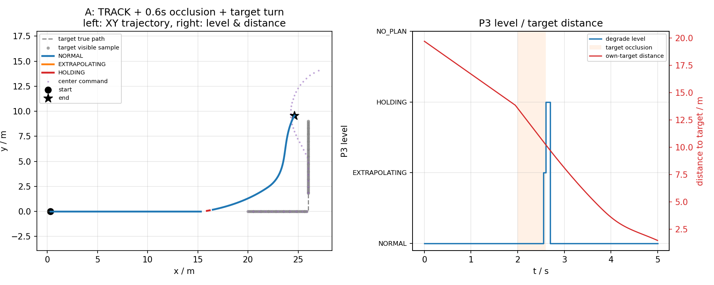
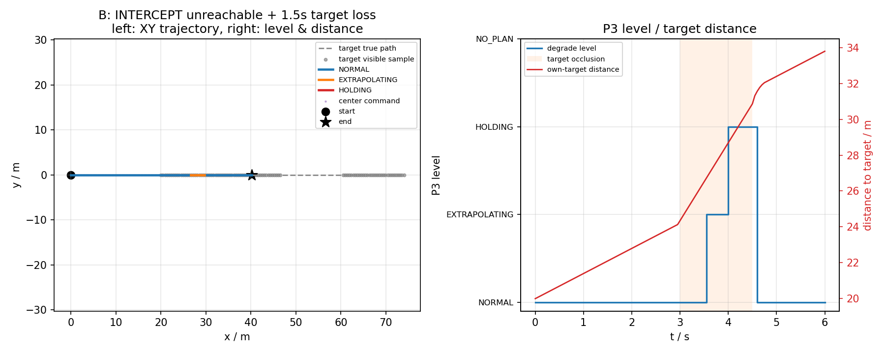
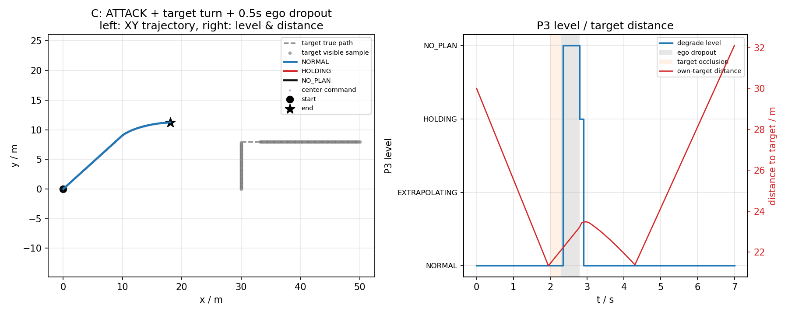

# P3 三个复杂场景仿真

> 目的：用 P1/P2/P3 的真实调用链，在时间上推进三个“目标机动 + 遮挡 +
> 丢失 + 己方断流”的场景，看无人机实际上会怎么动、P3 的状态机是否按
> 策略表工作。**这是纯算法 + 简化运动学仿真，不是 P4 联调验收。**

复现：

```bash
cd /home/silensky/Projects/ros2_ws
PYTHONPATH=src/algorithm_pkg /usr/bin/python3 \
    src/algorithm_pkg/test/simulate_p3.py
```

轨迹图输出到 `文档/figures/p3_scene_{a,b,c}.png`。

单帧调试/CSV：

```bash
# 场景 C 第 47 帧的输入检测 -> FSM -> P3 -> 中枢
PYTHONPATH=src/algorithm_pkg /usr/bin/python3 \
    src/algorithm_pkg/test/simulate_p3.py \
    --scenario C --tick 47 --no-plot

# 每帧导出 CSV
PYTHONPATH=src/algorithm_pkg /usr/bin/python3 \
    src/algorithm_pkg/test/simulate_p3.py \
    --scenario C --csv /tmp/p3_c.csv --no-plot
```

图的颜色/图例和四层调试方法见 `文档/P3调试方法.md`。

---

## 1. 仿真链路与模型

```text
目标真实位置
  -> 20Hz 采样（遮挡/丢失时停止采样）
  -> P1 predict_target(max_age=1.0, max_speed=15)
  -> P3 plan_with_degrade()（内部走 P2 plan() + 降级 + 护栏）
  -> 现状适配层：ATTACK 无解/失效时补当前位置保持点
  -> 中枢：TRACK 优先视觉，INTERCEPT/ATTACK 用规划点；两者都保留 2s
  -> 简化飞机：朝中枢指令点飞，速度 = v_max_for(action)
```

简化假设：

- 20Hz，位置积分，不考虑加速度/转弯半径/姿态；
- 单机，不考虑友军避障、真实传感器噪声、DDS 延迟；
- 中枢 TRACK 的 5m 环绕按 `TRACK_SAFE_DIST=5`、`push_force=(5-d)*1.5`
  模拟；它不是硬约束，近距离仍可能被目标“甩近”；
- 每个场景跑两遍：节点默认 `max_step=None`（不限幅）与“标定后”
  `max_step = v_max * 0.05s`，用来对照 P3 护栏是否生效。

---

## 2. 场景 A：TRACK + 0.6s 遮挡 + 目标转弯

### 设定

- 动作：`TRACK`；己方起点 `(0,0,10)`。
- 目标：前 2.0s 向东 3 m/s，从 `(20,0,10)` 到 `(26,0,10)`；
  2.0s 起改为向北 3 m/s。
- 遮挡：2.0～2.6s，目标不可见（0.6s）。
- 仿真 5.0s。

### 观察

| 时刻 | 事件 |
| --- | --- |
| 0.00s | NORMAL，TRACK 发目标预测点 |
| 2.00s | 进入遮挡，P1 继续用旧样本外推 |
| 2.55s | 目标年龄超过 0.5s 且连续 2 帧异常 → L1 `EXTRAPOLATING` |
| 2.60s | 目标重新出现；L1 → HOLDING 确认 |
| 2.70s | 连续 3 帧有效 → NORMAL |

| 指标 | 数值 |
| --- | --- |
| 级别分布 | NORMAL 98 / L1 1 / HOLDING 2 / L3 0 |
| L1 窗口 | 只有 1 帧（0.05s）：目标 0.6s 后就回来了，外推时间很短 |
| 准备发布点最大跳变（含适配层保持点） | 默认 0.926m；标定 `max_step=0.30` 后 0.300m |
| 中枢实际指令最大跳变 | 1.806m（TRACK 会叠加 5m 环绕） |
| 中枢保留指令 | 11 帧（0.55s），期间飞行 3.30m |
| TRACK 视觉覆盖 | 100 帧 |
| P3 点与中枢实际指令最大偏差 | 19.700m |
| 最小目标距离 | 1.48m |

图：`文档/figures/p3_scene_a.png`



### 怎么解释

- **P3 状态机正确**：目标短暂丢失时进 L1，目标回来后先 HOLDING 确认，
  3 帧有效后回 NORMAL；没有 L3、没有 NaN。
- **但当前中枢 TRACK 不执行 P3 的 TRACK 点**：`timer_callback` 的 TRACK
  分支优先用 `latest_vision_target`，P3 的预测/保持点只有在视觉丢失
  >2s 后才轮到。因此：
  - 遮挡 0.6s 期间，飞机继续朝“最后一次视觉原始位置”飞了 3.30m，
    而不是朝 P3 的外推点飞；
  - 表中 19.7m 的偏差，主要来自 `max_step=0.30` 时 P3 点被裁到己方附近，
    而中枢仍拿 20m 外的原始视觉目标当指令；
  - 这是 P4 的接口问题（谁优先、是否让规划接管 TRACK），不是 P3 的
    降级计算错误。
- 中枢的 5m 环绕是“软推力”，目标转弯时仍可能被甩到 1.48m；不是硬
  5m 安全距离。

---

## 3. 场景 B：INTERCEPT 追不上 + 目标丢失 1.5s

### 设定

- 动作：`INTERCEPT`；己方起点 `(0,0,10)`。
- 目标：向东 9 m/s，从 `(20,0,10)` 开始；己方拦截速度 7.6 m/s，
  直线追不上，P2 允许退化为尾随点（目标后方 4m）。
- 丢失：3.0～4.5s，目标不可见（1.5s）。
- 仿真 6.0s。

### 观察

| 时刻 | 事件 |
| --- | --- |
| 0.00s | NORMAL，首帧只有一帧目标，`velocity_unavailable` |
| 0.05s 起 | 速度估出，INTERCEPT 发尾随点 `fallback_tail` |
| 3.55s | 目标年龄超过 0.5s 且连续 2 帧 → L1 |
| 4.00s | 丢失超过 `t_extrap_max=1.0s` → L2 `HOLDING` |
| 4.60s | 目标回来，连续有效帧确认后 → NORMAL，恢复尾随 |

| 指标 | 数值 |
| --- | --- |
| 级别分布 | NORMAL 100 / L1 9 / HOLDING 12 / L3 0 |
| 尾随点帧数 | 107 |
| 最小目标距离 | 20.00m |
| 准备发布点最大跳变（含适配层保持点） | 默认 6.100m；标定 `max_step=0.38` 后 0.380m |
| 中枢实际指令最大跳变 | 0.380m（INTERCEPT 不叠加环绕） |
| 中枢保留指令 | 0 帧 |

图：`文档/figures/p3_scene_b.png`



### 怎么解释

- INTERCEPT 追不上时**可以**尾随：尾随点始终在目标后方 4m，`reason`
  是 `fallback_tail`，符合 P2 契约。
- 目标丢失 1.5s：先 L1 外推尾随点，超过 1.0s 后 L2 保持最后有效点，
  飞机在保持点上停住；目标回来后恢复尾随。没有 L3。
- 默认 `max_step=None` 时，L2 恢复那一帧的指令点跳了 6.1m；标定
  `max_step=0.38` 后，P3 护栏把它压到 0.38m。**状态正确，但“跳变
  是否可接受”取决于 `max_step` 是否标定。**

---

## 4. 场景 C：ATTACK + 目标转弯 + 0.5s 己方断流

### 设定

- 动作：`ATTACK`；己方起点 `(0,0,10)`。
- 目标：前 2.0s 向北 6 m/s，从 `(60,0,10)` 到 `(60,12,10)`；
  2.0s 起改为向东 6 m/s。
- 遮挡：2.0～2.8s（0.8s）。
- 己方断流：2.3～2.8s（0.5s），规划侧 `own=None`。
- 仿真 7.0s。

### 观察

| 时刻 | 事件 |
| --- | --- |
| 0.00s | NORMAL，首帧 `velocity_unavailable`，适配层补保持点 |
| 0.05s 起 | 速度估出，ATTACK 发拦截点 |
| 2.00s | 目标转弯 + 遮挡，P1 开始用旧速度外推 |
| 2.30s | 己方状态断流，NORMAL 下 `own_invalid`，不发新点 |
| 2.35s | 连续 2 帧己方异常 → L3 `NO_PLAN`，`no_plan_ego_lost` |
| 2.80s | 己方恢复；目标也回来；L3 → HOLDING |
| 2.90s | 连续有效帧 → NORMAL，恢复 ATTACK 拦截点 |

| 指标 | 数值 |
| --- | --- |
| 级别分布 | NORMAL 130 / L1 0 / HOLDING 2 / L3 9 |
| 尾随点帧数 | 0（ATTACK 从不尾随） |
| 最小目标距离 | 15.83m |
| 准备发布点最大跳变（含适配层保持点） | 默认 68.751m；标定 `max_step=0.62` 后 0.620m |
| 纯 P3 输出最大跳变（不含保持点） | 默认 8.401m；标定 `max_step=0.62` 后 0.620m |
| 中枢实际指令最大跳变 | 0.620m（ATTACK 不叠加环绕） |
| 中枢保留指令 | 9 帧（0.45s） |
| 保留期间飞行 | 默认 `max_step=None` 时 5.58m；标定时 0.00m |

图：`文档/figures/p3_scene_c.png`



### 怎么解释

- ATTACK 从不输出尾随点：整场 `fallback_tail` 计数为 0；无解/丢失时
  P3 用显式保持点或 no_plan。
- 己方断流 0.5s：P3 正确进 L3，`reason=no_plan_ego_lost`；恢复后经
  HOLDING 确认回 NORMAL。
- **L3 期间中枢仍按 2s 保留旧指令**：
  - 默认 `max_step=None` 时，最后一个规划点可能在很远处，飞机在 L3 的
    0.45s 里仍沿旧指令飞了 5.58m；
  - 标定 `max_step=0.62` 后，规划点每帧只走 0.62m，旧点就在己方附近，
    L3 期间实际只飞 0.00m。
  - 这说明 `max_step` 不只是“平滑输出”，也间接限制了中枢保留旧点造成
    的盲飞距离。
- 默认 `max_step=None` 时，首帧“适配层保持点 → 拦截点”的指令跳变达
  68.75m；标定后压到 0.62m。**护栏已实现，但节点默认没启用。**

---

## 5. 判定结论

### 算法层（P3）

| 检查 | 结果 |
| --- | --- |
| 三场景无 NaN/Inf、无越界 | PASS |
| L1/L2/L3 状态与策略表一致 | PASS |
| 时间戳/遮挡期间不崩 | PASS |
| INTERCEPT 尾随、ATTACK 不尾随 | PASS |
| 恢复经 HOLDING 确认、回 NORMAL | PASS |
| P3 护栏把点跳变压到 `max_step` | PASS（标定后） |

### 系统层（需要 P4 决策）

1. **TRACK 的 P3 点当前不会被执行**：中枢优先视觉原始目标，P3 的
   TRACK 外推/保持只有在视觉丢失 >2s 后才生效。
2. **中枢 2s 保留旧指令**：L3 时规划说“别发点”，但中枢还会继续发旧点；
   `max_step` 标定得越小，盲飞距离越短。
3. **默认 `max_step=None`**：节点启动参数是 0（不限幅），首帧/恢复帧
   可能出现几十米的指令跳变；建议 P4 至少标定到 `v_max * 0.05s`。
4. **TRACK 5m 环绕是软约束**：目标转弯时最小距离仍可能到 1.48m。
5. **首帧 `velocity_unavailable`**：ATTACK 在只有一帧目标时会补保持点，
   下一帧才发拦截点；这是 P2 既定行为。

### 这个仿真不能证明什么

- 不能替代 P4 的真实 ROS/DDS/话题/QoS 联调；
- 不能证明飞控能跟踪这些指令（没有加速度/姿态/控制环）；
- 不能证明多机隔离、避障、传感器噪声下的行为；
- 不能证明中枢 2s 保留在真实时序下一定成立（这里按代码逻辑简化）。

---

## 6. 复现与输出字段

```bash
cd /home/silensky/Projects/ros2_ws
PYTHONPATH=src/algorithm_pkg /usr/bin/python3 \
    src/algorithm_pkg/test/simulate_p3.py
```

同一组场景也固化在 pytest 里（失败返回非 0，图表不参与断言）：

```bash
PYTHONPATH=src/algorithm_pkg /usr/bin/python3 -m pytest -q \
    src/algorithm_pkg/test/test_scenario_p3.py

# 只跑场景 A、写 JSON 摘要
PYTHONPATH=src/algorithm_pkg /usr/bin/python3 \
    src/algorithm_pkg/test/simulate_p3.py --scenario A --no-plot \
    --json /tmp/p3_a.json
```

每个场景输出：

- 级别分布、准备发布点数、中枢实际指令点数、最小目标距离；
- 默认/标定两种 `max_step` 下的纯 P3 输出跳变、准备发布点跳变、中枢实际指令跳变（三个口径分开）；
- 尾随点数、中枢保留指令帧数与保留期间飞行距离；
- 级别迁移表（时刻、级别、anomaly、reason）；
- 硬检查（NaN/越界/NO_PLAN 是否生成新点）与场景专属 PASS/FAIL；
- 轨迹图路径。

脚本中的场景参数、目标航路、遮挡/断流窗口都在
`src/algorithm_pkg/test/simulate_p3.py` 顶部，改完直接重跑即可。
