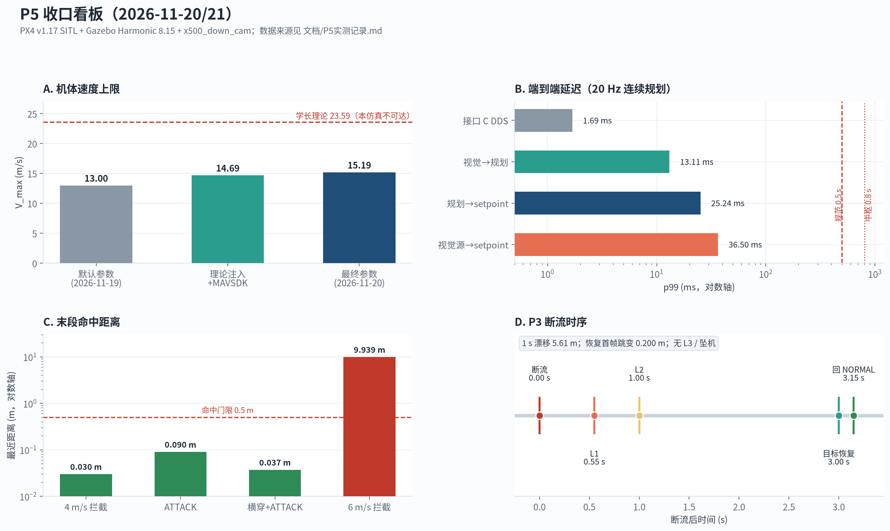
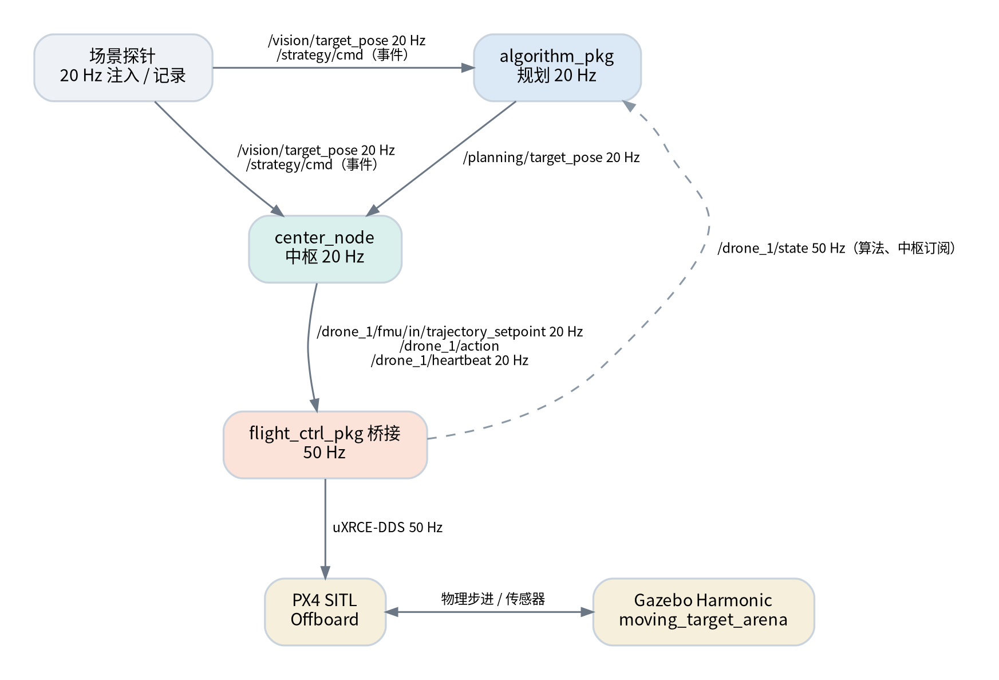
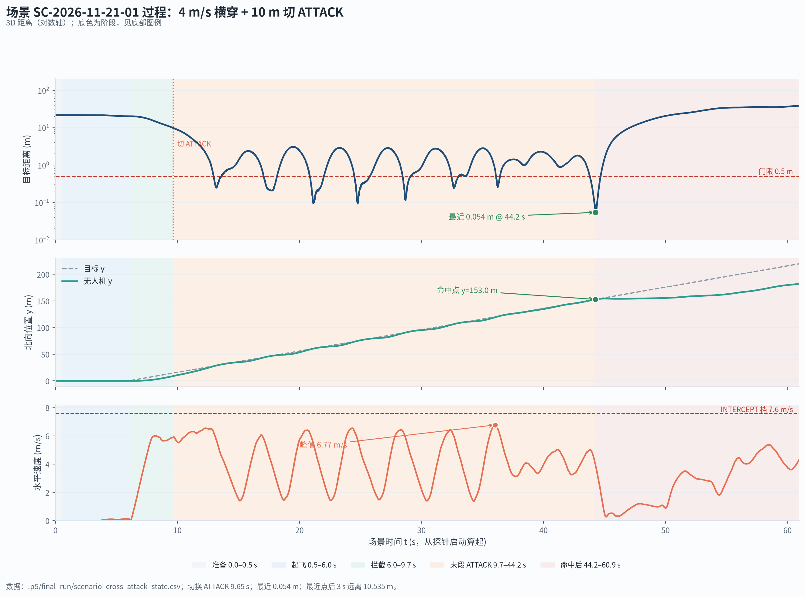
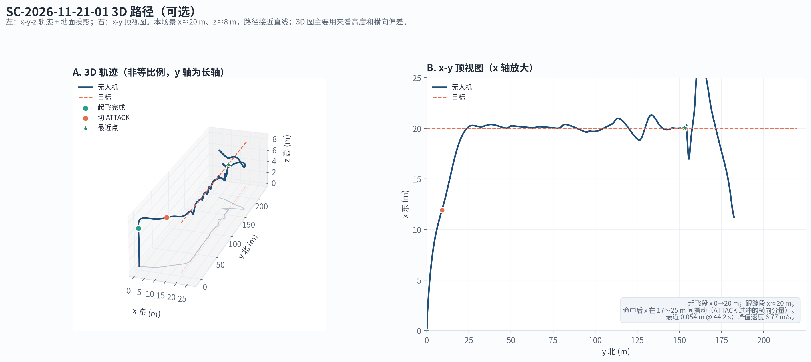

# 算法测试基本方法

本文件说明算法包的测试分层、调试方法、必做场景和故障排查流程，用于真机联调前的验证与问题定位。

测试分四层，执行顺序不可颠倒：底层不通过时，中层结果无意义；中层不通过时，不应进入物理仿真；物理仿真不通过时，不应进入真机。三个 P3 场景、P5 四步收口和一个 Gazebo 场景报告为必做项。

---

## 1. 测试分层

| 层 | 数量 | 覆盖目标 | 执行时间 |
|---|---|---|---|
| 单元测试 | 209 | 数学计算、边界条件、输出约束顺序 | 秒级 |
| 场景回归 | 5 | 状态机迁移、滞回、保留旧点导致的飞行 | 秒级 |
| 联调脚本 | 5 个 | 话题、字段、时间戳、多机隔离 | 分钟级 |
| 物理仿真（SITL） | 4 项 + 1 个场景 | PX4/Gazebo 闭环、桥接限幅、DDS、动力学 | 分钟级 |

单元测试覆盖单函数、单帧的正确性。例如拦截方程判别式在 0 附近因浮点误差变为负值、`A≈0` 时退化为一次方程、输出约束将高度裁剪到包线外。此类问题单帧即可暴露。

场景回归覆盖连续多帧的正确性。目标在过期边界附近波动时，逐帧独立判断会导致输出在“有点 / 无点”之间反复切换；滞回、恢复计数、中枢保留旧点三者只在连续 20 Hz 推进时相互影响。单元测试使用静态输入，无法覆盖此类问题。

联调脚本覆盖节点间连接的正确性。话题名称错误、JSON 字段缺失、多机串号、时间戳时钟不一致等问题无法由 pytest 发现。

物理仿真覆盖 PX4/Gazebo 闭环。单元和场景测试用简化飞行器，发现不了桥接限幅、PX4 动力学、DDS 时序、执行器饱和的问题。

新用例的层次选择依据：

- 验证“给定输入时，函数返回什么点、什么原因”：单元测试，断言精确值；
- 验证“连续若干帧内级别是否反复切换、发布点是否停留在旧点”：场景回归；
- 验证“两个 ROS 节点之间的字段、时间戳、话题是否正确”：联调脚本。

若一个用例既无法断言精确值，也无法推进时间，说明测试目标尚未明确。

### 执行命令

```bash
# 全部
PYTHONPATH=src/algorithm_pkg /usr/bin/python3 -m pytest -q src/algorithm_pkg/test

# 单文件
PYTHONPATH=src/algorithm_pkg /usr/bin/python3 -m pytest -q \
    src/algorithm_pkg/test/test_safety_guard.py

# 单个用例
PYTHONPATH=src/algorithm_pkg /usr/bin/python3 -m pytest -q \
    src/algorithm_pkg/test/test_safety_guard.py::test_step_limited

# 按名称筛选
PYTHONPATH=src/algorithm_pkg /usr/bin/python3 -m pytest -q \
    src/algorithm_pkg/test -k extrapolating
```

运行结束后会输出“算法实测结果”，每条用例三行：场景、预期、实测。`measured()` 记录本次运行的实际数值。仅查看 `214 passed` 不足以确认测试内容；临时调试可增加 `-s` 参数查看 `print` 输出。

---

## 2. 调试方法

测试分层说明“测什么”，本节说明“从哪一层定位问题”。各层能力范围不同：

| 层次 | 可回答的问题 | 不可回答的问题 |
|---|---|---|
| 单函数 / pytest | 某个分支在给定输入下的返回值 | 连续 20 帧是否抖动、是否累积状态 |
| 单帧 CLI | 当前帧的检测分类、状态机、约束、输出 | 下一帧状态机如何迁移 |
| 场景回放 | 丢失→L1→L2→恢复的完整时间线、指令跳变 | 真实 ROS 时延、DDS、QoS |
| 系统联调 | 话题是否连通、时间戳来源、中枢实际行为 | 算法内部分支的精确语义 |

推荐顺序：先用 pytest 定位出错的分支，再用单帧 CLI 查看该帧中间量，最后用场景回放确认连续多帧稳定。仅观察场景图容易受中枢 2 s 保留和 TRACK 视觉优先等外部行为影响。

### 2.1 单函数（pytest）

```bash
# 失败时进入 pdb
PYTHONPATH=src/algorithm_pkg /usr/bin/python3 -m pytest -q \
    src/algorithm_pkg/test/test_degrade_policy.py --pdb
```

测试文件与覆盖范围：

- `test_validators.py`：输入分类（FRESH/STALE/INVALID/…）；
- `test_degrade_fsm.py`：级别迁移、滞回、时间戳倒退、恢复；
- `test_degrade_policy.py`：四个级别 × 七种动作的关键路径；
- `test_safety_guard.py`：六步输出约束及顺序；
- `test_replay_anomaly.py`：11 组异常回放。

适用场景：怀疑判断条件、边界值或动作语义实现错误。

### 2.2 单帧（`simulate_p3.py --tick`）

```bash
# 场景 C 第 47 帧（t=2.35 s，己方状态中断触发 L3）
PYTHONPATH=src/algorithm_pkg /usr/bin/python3 \
    src/algorithm_pkg/test/simulate_p3.py --scenario C --tick 47 --no-plot

# 对照节点默认 max_step=None 时同一帧的结果
PYTHONPATH=src/algorithm_pkg /usr/bin/python3 \
    src/algorithm_pkg/test/simulate_p3.py --scenario C --tick 47 --no-plot --params default
```

输出包含两部分：相邻 ±3 帧的简表，以及选中帧的完整链路。

```text
己方输入 -> P1 目标状态 -> 目标检测 -> 己方检测 -> FSM 迁移
        -> P3 结果（point/reason/guard_notes）
        -> 适配层兜底点 plan_point
        -> 中枢实际指令 published
```

读取顺序：

1. `target_visible / ego_dropped`：当前帧缺失的输入；
2. 目标检测 / 己方检测：属于 STALE、INVALID、TIME_REVERSED 还是 MISSING；
3. FSM 迁移：`previous -> current`、`reason`、`changed`，同时检查 `bad_frames / good_frames` 的滞回状态；
4. P3 结果：`level / reason / point / guard_notes`；
5. `plan_point` 与 `published`：前者是适配层兜底后的点，后者是中枢实际指令。两者不同通常由中枢 2 s 保留或 TRACK 视觉优先导致，不是 P3 计算错误。

适用场景：场景图中某时刻出现非预期降级，需要定位具体帧和触发原因。

### 2.3 场景回放

```bash
# 运行三个场景，输出摘要、级别迁移和判定结果，并更新轨迹图
PYTHONPATH=src/algorithm_pkg /usr/bin/python3 \
    src/algorithm_pkg/test/simulate_p3.py

# 仅运行场景 C，导出逐帧 CSV
PYTHONPATH=src/algorithm_pkg /usr/bin/python3 \
    src/algorithm_pkg/test/simulate_p3.py --scenario C --csv /tmp/p3_c.csv
```

三个跳变指标含义不同，不可混用：

- `p3_jump`：P3 输出的 `PlanResult.point`；
- `plan_jump`：适配层准备发布的点，包含 ATTACK 保持点；
- `published_jump`：中枢实际指令，TRACK 会叠加 5 m 环绕。

`--json PATH` 输出每个场景的摘要、失败项和迁移表；全部通过时退出码为 0，存在失败项时为 1。图表仅作为证据，不参与断言。

场景已固化为 pytest 用例，可直接用于 CI：

```bash
PYTHONPATH=src/algorithm_pkg /usr/bin/python3 -m pytest -q \
    src/algorithm_pkg/test/test_scenario_p3.py
```

### 2.4 系统联调

联调脚本位于 `src/algorithm_pkg/scripts/p4/`：

```bash
# 冒烟脚本自行启动节点
PYTHONPATH=src/algorithm_pkg /usr/bin/python3 \
    src/algorithm_pkg/scripts/p4/smoke_node.py

# 其余脚本需先启动被测节点，命令见 scripts/p4/README.md
```

主机没有 ROS 环境时，在 Humble 或 Jazzy 容器中运行，见 `src/algorithm_pkg/README.md` 的“运行”。

---

## 3. 三个必做场景

本节为验收必做项。场景回归不通过时，即使单元测试全部通过，也不能视为完成。

### 3.1 仿真模型与假设

```text
目标真实位置
  -> 20 Hz 采样（遮挡或丢失时停止采样）
  -> P1 predict_target(max_age=1.0, max_speed=15)
  -> P3 plan_with_degrade()（内部依次执行 P2 plan()、降级、输出约束）
  -> 适配层：ATTACK 无解或失效时补当前位置保持点
  -> 中枢：TRACK 优先视觉，INTERCEPT/ATTACK 使用规划点；两者均保留 2 s
  -> 简化飞行器：朝中枢指令点飞行，速度由 v_max_for(action) 决定
```

假设条件：20 Hz 位置积分；不考虑加速度、转弯半径、姿态、友军避障、传感器噪声和 DDS 延迟。中枢 TRACK 的 5 m 环绕按 `push_force=(5-d)*1.5` 软推力模拟，不是硬约束。

每个场景执行两次：节点默认 `max_step=None`（不限幅）和标定后的 `max_step = V_max × 0.05 s = 0.30 m`，用于对照输出约束是否生效。

场景参数随《内部分工细节》调整过一次：`V_max=6.0 m/s` 后，场景 C 的目标速度由 6 m/s 调整为 4 m/s，起始距离由 60 m 调整为 30 m。原因：同速横穿时方程无解，60 m 超出 `t_go_max=8 s` 对应的 48 m 可达范围。

### 3.2 场景 A：TRACK + 0.6 s 遮挡 + 目标转弯

设定：`TRACK`；己方起点 `(0,0,10)`；目标前 2.0 s 向东 3 m/s，之后向北 3 m/s；遮挡区间 2.0～2.6 s；仿真时长 5.0 s。

| 时刻 | 事件 |
|---|---|
| 0.00 s | NORMAL，TRACK 发布目标预测点 |
| 2.00 s | 进入遮挡，P1 使用旧样本外推 |
| 2.55 s | 年龄超过 0.5 s 且连续 2 帧异常，进入 L1 |
| 2.60 s | 目标重新出现，L1 → HOLDING 确认 |
| 2.70 s | 连续 3 帧有效，回到 NORMAL |

| 指标 | 数值 |
|---|---|
| 级别分布 | NORMAL 98 / L1 1 / L2 2 / L3 0 |
| 准备发布点跳变 | 默认 0.926 m；标定后 0.300 m |
| 中枢指令跳变 | 1.806 m（TRACK 叠加 5 m 环绕） |
| 中枢保留 | 11 帧（0.55 s），期间飞行 3.30 m |
| 视觉覆盖 | 100 帧 |
| P3 点与中枢指令最大偏差 | 19.70 m |
| 最小目标距离 | 1.48 m |

说明：状态机迁移正确，但中枢 TRACK 分支不执行本包发布的点（`center_node.py:592`）。遮挡期间飞行器朝最后一次视觉原始位置飞行，而不是朝外推点。19.70 m 偏差主要来自该覆盖行为，不是 P3 计算错误。

### 3.3 场景 B：INTERCEPT 追不上 + 目标丢失 1.5 s

设定：`INTERCEPT`；目标向东 9 m/s（快于己方 6.0 m/s），直线追击不可达，允许退化为尾随点；目标丢失区间 3.0～4.5 s；仿真时长 6.0 s。

| 时刻 | 事件 |
|---|---|
| 0.00 s | NORMAL，首帧只有一帧目标，`velocity_unavailable` |
| 0.05 s 起 | 速度估计完成，发布尾随点 `fallback_tail` |
| 3.55 s | 年龄超过 0.5 s 且连续 2 帧异常，进入 L1 |
| 4.00 s | 丢失超过 `t_extrap_max=1.0 s`，进入 L2 |
| 4.60 s | 目标恢复，确认后回到 NORMAL，恢复尾随 |

| 指标 | 数值 |
|---|---|
| 级别分布 | NORMAL 100 / L1 9 / L2 12 / L3 0 |
| 尾随点帧数 | 107 |
| 最小目标距离 | 20.00 m |
| 准备发布点跳变 | 默认 6.100 m；标定后 0.300 m |
| 中枢指令跳变 | 0.300 m（INTERCEPT 不叠加环绕） |
| 中枢保留 | 0 帧 |

说明：追击不可达时退化为尾随点属于约定语义，`reason=fallback_tail`。默认 `max_step=None` 时，恢复帧的指令跳变为 6.1 m；标定后限制为 0.30 m。

### 3.4 场景 C：ATTACK + 目标转弯 + 0.5 s 己方状态中断

设定：`ATTACK`；目标前 2.0 s 向北 4 m/s，从 `(30,0,10)` 到 `(30,8,10)`，之后向东 4 m/s；遮挡区间 2.0～2.8 s；己方状态中断区间 2.3～2.8 s；仿真时长 7.0 s。

| 时刻 | 事件 |
|---|---|
| 0.00 s | NORMAL，首帧 `velocity_unavailable`，适配层补保持点 |
| 0.05 s 起 | 速度估计完成，发布拦截点（74 帧） |
| 2.30 s | 己方状态中断，`own_invalid`，不发布新点 |
| 2.35 s | 连续 2 帧己方异常，进入 L3，`no_plan_ego_lost` |
| 2.80 s | 己方状态恢复，L3 → HOLDING |
| 2.90 s | 确认后回到 NORMAL，恢复拦截点 |

| 指标 | 数值 |
|---|---|
| 级别分布 | NORMAL 130 / L1 0 / L2 2 / L3 9 |
| 规划点数 | 76（拦截 74 + L2 保持 2）；另有 54 帧 ATTACK 无解，由适配层补保持点 |
| 尾随点帧数 | 0（ATTACK 不退化为尾随点） |
| 最小目标距离 | 21.33 m |
| P3 输出跳变 | 默认 7.020 m；标定后 0.300 m |
| 准备发布点跳变 | 默认 46.945 m；标定后 0.300 m |
| 中枢保留 | 9 帧（0.45 s） |
| 保留期间飞行 | 默认 2.70 m；标定后 0.00 m |

说明：ATTACK 不输出尾随点；无解时由 P3 补显式保持点，适配层不重复补充。L3 期间中枢仍按 2 s 保留发送旧指令，因此“本包不发布”不等于“飞行器立即停止”。标定 `max_step` 后，旧点位于己方附近，保留期间飞行距离为 0。

### 3.5 图表说明

`plot_scene()` 使用 matplotlib（Agg 后端）生成图表，保存至 `文档/figures/p3_scene_{a,b,c}.png`。每次执行完整仿真会覆盖更新。图表仅作为证据，不参与断言。

左图为 XY 轨迹（ENU，米）：

| 图例 | 含义 |
|---|---|
| 灰色虚线 `target true path` | 目标真实路径，算法不可见 |
| 灰点 `target visible sample` | 目标可见时的采样点 |
| 蓝 / 橙 / 红 / 黑线 | NORMAL / L1 / L2 / L3 航迹 |
| 紫点 `center command` | 中枢实际指令（含 5 m 环绕和 2 s 保留） |
| 黑圆 / 黑星 | 起点 / 终点 |

右图为级别与距离：蓝色阶梯为降级级别，红色实线为己方到目标的真实距离，橙色带为目标不可见区间，灰色带为己方状态中断区间。

读取顺序：先查看色带区间（确认缺失的输入），再查看级别阶梯（确认迁移是否符合策略），再查看距离（L2 期间是否停止增长、L3 期间是否继续增长），最后比较紫色指令点与航迹（确认中枢是否覆盖了本包的输出）。

### 3.6 新增场景

在 `simulate_p3.py` 的 `build_scenarios()` 中增加一项：

```python
{
    "name": "D",
    "title": "D: 场景说明",
    "action": "TRACK",              # TRACK / INTERCEPT / ATTACK
    "own_start": (0.0, 0.0, 10.0),
    "duration": 6.0,
    "max_step": 0.30,               # V_max * DT
    "target_fn": _target_d,         # t -> (x, y, z)
    "visible_fn": _visible_d,       # t -> bool
    "ego_dropout_fn": _ego_dropout_d,
}
```

执行单帧和 CSV 输出，确认迁移符合预期：

```bash
PYTHONPATH=src/algorithm_pkg /usr/bin/python3 \
    src/algorithm_pkg/test/simulate_p3.py --scenario D --tick 40 --no-plot
PYTHONPATH=src/algorithm_pkg /usr/bin/python3 \
    src/algorithm_pkg/test/simulate_p3.py --scenario D --csv /tmp/p3_d.csv
```

需要作为回归用例时，在 `check_common` 或场景专属判定中增加断言，并将预期迁移写入 `src/algorithm_pkg/README.md` 的“异常降级与安全约束”。

---

## 4. 设定值抖动排查

症状：设定值在两点之间反复变化。

按以下顺序检查：

### 4.1 输出约束是否生效

输出约束的裁剪记录为 debug 级日志，默认 INFO 级别不可见。先将节点日志级别调整为 debug：

```bash
ros2 run algorithm_pkg algorithm_node --ros-args --log-level debug
# 或对已启动节点设置
ros2 service call /algorithm_node/set_logger_level rcl_interfaces/srv/SetLoggerLevel \
  "{logger: 'algorithm_node', level: 'debug'}"
```

查看记录：

```bash
grep "护栏裁剪" algo.log | head
```

正常输出包含 `xy_clamped`、`z_clamped`、`step_clamped:0.900->0.300` 等记录。若相邻两帧位移超过 `max_step=0.30 m` 但未出现 `step_clamped`，说明约束未生效，属于缺陷。

确认参数实际值：

```bash
ros2 param get /algorithm_node max_step
```

`0` 表示不限幅，仅用于调试。launch 默认值为 0.30；被命令行覆盖为 0 是常见配置错误。

### 4.2 恢复期参数是否过紧

`max_step_recover=0.2 m/帧` 限制恢复第一帧的跳变，随后按 `n_recover_step=5` 帧放开。

判断依据：`HOLDING->NORMAL` 前后，若设定值长期停留在原处或在小区间内往返，优先检查该参数。0.2 m/帧对应约 4 m/s，低于 `V_max` 6.0 m/s。

同时检查级别是否频繁切换：

```bash
grep "降级级别变化" algo.log
```

`NORMAL->EXTRAPOLATING->HOLDING->NORMAL` 在 1 秒内反复出现，说明目标源在过期边界附近波动，或 `max_pred_age` 接近源帧率。

### 4.3 模式切换时的速度变化

P4 mock 下 TRACK、INTERCEPT、ATTACK 的速度上限均为 6.0 m/s；P5 SITL 最终为 4.5 / 7.6 / 14.8 m/s，见第 8 章。切换动作本身不应引入速度突变。若切换瞬间出现跳变，按以下顺序检查：

- 目标点本身是否跳变（见 4.4）；
- 中枢限幅与本包 `max_step` 是否一致，中枢有独立的限幅逻辑。

输出约束会将每帧跳变限制在 0.30 m 以内。若约束后仍存在抖动，问题位于约束之后，需检查飞控和中枢限幅。

### 4.4 区分目标抖动与输出抖动

使用单帧回放：

```bash
PYTHONPATH=src/algorithm_pkg /usr/bin/python3 \
    src/algorithm_pkg/test/simulate_p3.py --scenario C --tick 120 --no-plot
```

输出包含当前帧的目标输入、检测分类、FSM 状态、P2 输出和约束结果。逐层比对：

- 目标输入抖动：上游视觉或外部源问题；
- 输入稳定、P2 输出抖动：动作或速度参数变化；
- P2 稳定、约束输出抖动：约束未生效或参数被覆盖。

导出 CSV 后可逐帧比对：`p3_x/y/z` 为规划点，相邻帧差值应小于等于 `max_step`；`published_x/y/z` 为模拟中枢实际执行的点，`using_retained` 标识该帧是否仍在使用保留的旧点。

---

## 5. 无规划点或执行旧点排查

先确认本包是否发布了规划点：

```bash
ros2 topic echo /planning/target_pose --once
ros2 topic hz /planning/target_pose
```

未发布时检查“本帧不发点”日志；已发布但未执行时转至 5.3。

### 5.1 本包未发布规划点

```bash
grep "本帧不发点" algo.log | tail -20
```

按 `reason` 分类：

| reason | 含义 | 检查项 |
|---|---|---|
| `target_missing` | 未收到任何目标 | 目标源话题、QoS、命名空间 |
| `target_invalid` | 目标 NaN、越界或时间戳非法 | 视觉输出、坐标系、`max_xy` / `max_alt` |
| `target_too_old` | 预测年龄 > 0.5 s | 源帧率、时钟、`max_pred_age` 配置 |
| `own_invalid` | 己方位置缺失或非有限值 | `/drone_x/state`、桥接 |
| `velocity_unavailable` | INTERCEPT/ATTACK 尚未估计出速度 | 目标至少两帧、时间跨度 |
| `attack_no_solution` | ATTACK 追击不可达 | 正常降级，不是缺陷 |
| `unknown_action` | 指令拼写错误 | `/strategy/cmd` 内容 |
| `no_plan_ego_lost` | L3：己方状态中断或非法 | `/drone_x/state`、`ego_timeout` |
| `no_plan_target_invalid` | L3：目标 NaN 或越界 | 视觉输出、边界参数 |
| `no_plan_target_stale` | L3：目标仅处于过期状态 | 源帧率、时钟 |
| `no_plan_hold_unavailable` | L3：无法获取保持点 | 己方位置、上一有效点 |

`hold_last_valid`、`hold_current_ego`、`hold_attack_no_solution` 为保持点原因，属于正常降级，不是故障。

### 5.2 时间戳过滤导致帧被丢弃

适配层在入口丢弃三类帧，日志原文如下：

```text
丢弃视觉帧：stamp_zero
丢弃视觉帧：stamp_future
丢弃外部目标帧：stamp_reversed
```

典型现象：目标在运动中，但本包报告无目标。排查顺序：

1. 发布端是否使用 ROS clock。使用 `time.time()` 生成的时间戳与 ROS clock 存在纪元差，会被判定为超前。
2. 是否存在两个节点使用不同时钟源。
3. 是否存在回灌带入旧时间戳。
4. 首帧时间戳是否为 0（部分驱动首帧不填）。

上述帧被丢弃是正确行为，不应修改过滤逻辑，应修正发布端。

### 5.3 已发布但未执行或执行旧点

该类问题位于中枢侧，按以下顺序排查：

1. **中枢保留旧点**：停止发布后最长 2 s 仍按上一帧点执行，实测 1.98 s。本包 `max_step` 只能缩短保留期间的飞行距离，不能使中枢立即停止。
2. **TRACK 视觉优先**：TRACK 下中枢直接使用视觉目标，不读取规划点（`center_node.py:592`）。
3. **`action` 不是控制输入**：中枢 `plan_callback` 不解析该字段。
4. **进入无分支模式**：`RESUME_PATROL` 或未知动作会使中枢记录模式但没有对应分支，此后不再发布 setpoint。
5. **规划消息被中枢丢弃**：中枢 `max_plan_delay=0.8 s`，本包 `stamp` 是源头时刻；规范写 0.5 s，阈值未统一，跨机联调前需对时。

判断方法：使用 `ros2 topic echo /<drone_id>/setpoint_raw/local` 查看中枢是否发布、发布内容。若中枢持续发布旧点，问题不在本包。

---

## 6. 缺陷处理流程

顺序固定，不允许跳过。

1. **先编写能复现缺陷的失败测试**。放入 `src/algorithm_pkg/test/`，使用 pytest 函数，docstring 写明“场景 / 预期”。不编写测试直接修改代码，无法证明缺陷已修复。
2. **确认失败原因与现场一致**：`pytest -q <file>::<test>` 必须失败，且失败原因与现场现象一致。原因不一致说明复现错误。
3. **修复**：只修改必要位置，不进行无关重构。
4. **运行全量测试**：214 项必须全部通过。
5. **确认场景指标未退化**：三个场景的保留期间飞行距离、跳变、最小目标距离与修改前对比。指标退化说明修复引入了其他风险。
6. **最后进行真机验证**：先执行 `src/algorithm_pkg/scripts/p4/smoke_node.py` 冒烟，再执行单机闭环，最后执行失效注入。

涉及其他包的问题，按附录 A 的格式记录，不在本包改。

两条约束：

- 不得修改断言以适配代码。断言本身错误时，应单独说明依据，不能为通过而删除条件。
- 修改阈值必须写明依据：对应的真机数据、数据来源、物理量换算。`max_step=0.30` 的依据是 `V_max` 6.0 m/s × 0.05 s。

---

## 7. 取证清单

真机验证前，将以下材料保存到仓库或 issue，不保留在终端中。

| 证据 | 命令 |
|---|---|
| 测试结果 | `pytest -q ... \| tail -30` |
| 场景 CSV | `simulate_p3.py --csv /tmp/scene.csv` |
| 场景摘要 JSON | `simulate_p3.py --json /tmp/scene.json` |
| 节点日志 | 启动时重定向：`ros2 launch ... > /tmp/algo.log 2>&1` |
| 话题频率 | `ros2 topic hz /planning/target_pose` |
| 话题内容 | `ros2 topic echo /planning/target_pose --once` |
| 参数实际值 | `ros2 param get /algorithm_node max_step` |
| P5 四步日志 | `.p5/final_run/01_dynamics.log`、`07_latency.log`、`08_intercept4.log`、`05_attack.log`、`13_recovery_far.log` |
| 场景状态/规划 CSV | `.p5/final_run/scenario_cross_attack_state.csv`、`_plan.csv` |
| 场景图 | `MPLCONFIGDIR=/tmp/mplconfig .p5/charts_venv/bin/python .p5/make_scenario_chart.py` |

日志节流会合并重复输出：级别变化 0.1 s、丢弃帧 1.0 s、“本帧不发点”1.0 s、输出约束裁剪 5.0 s。统计频率时应按节流窗口换算，不能按日志行数计算。

---

## 8. P5 物理仿真（PX4 SITL）

P5 在 `p5_sitl` 容器里跑 PX4 v1.17 SITL、Gazebo Harmonic 8.15、MicroXRCE-DDS Agent 2.4.3，机型 `x500_down_cam`。算法不直连 PX4，链路是 `algorithm_pkg` → 中枢 → main 的 `flight_ctrl_pkg` 桥接 → PX4 → Gazebo。

### 8.1 环境与启动

| 项 | 值 |
|---|---|
| ROS | Humble（容器 `p5_sitl`） |
| Gazebo | Harmonic 8.15.0 |
| PX4 | v1.17.0，源码 `.p5/px4_v117/PX4-Autopilot` |
| uXRCE-DDS Agent | v2.4.3，`.p5/third_party/uxrce_agent_install` |
| `px4_msgs` | 按 PX4 v1.17 固件树重新生成 |
| 工作区 | `.p5/main_ws`（基于 origin/main，未合并） |

`.p5` 已 git ignore。PX4 源码和编译产物放在 `/home`，不占 `/`。

启动整栈：

```bash
cd .p5/main_ws
./run_p5_theory.sh
```

测试时用启停脚本，避免上一项姿态污染下一项：

```bash
docker exec p5_sitl bash /root/ros2_ws/.p5/p5_stack.sh start
docker exec p5_sitl bash /root/ros2_ws/.p5/p5_stack.sh stop
```

日志：`.p5/final_run/`（测试）和 `.p5/theory_run/`（整栈）。容器依赖见 `文档/Jazzy开发与Humble交付指南.md` 的 3.5 节。

理论参数注入有三处：

- `px4_runtime_inject.py`：用 MAVSDK 在运行时改 PX4 参数（26/48/12/4.5/185.2），不改 main 文件；
- `theory_bridge_params.yaml`：桥接三档 `max_step`，最终为 0.225 / 0.38 / 0.74；
- `algorithm.launch.py`：算法侧参数，最终为 4.50 / 7.60 / 14.80。

这些理论值只作参考，不是本机实测。本仿真上限约 14.8 m/s，23.59 不可达。

### 8.2 参数口径

| 参数 | 学长理论 | 本机实测 | 最终运行 |
|---|---:|---:|---:|
| `v_max` | 4.50 | 5.49 | 4.50 |
| `v_max_intercept` | 7.60 | — | 7.60 |
| `v_max_attack` | 23.59 | 14.69 | 14.80 |
| `a_max` | 10.82 | 9.79 | 9.79 |
| `yaw_rate_max` | 185.2°/s | 172.4°/s | 172.4°/s |
| `max_step` | 1.1795 | — | 0.74 |
| `max_step_recover` | — | 0.2 | 0.2 |
| `min_distance` | — | 0.5 | 0.5 |

PX4 参数 26/48/12/4.5/185.2 已确认 set 成功并读回一致，但 V_max 仍只有 14.8。瓶颈是 main 的模型/控制器在 48° 倾角下的实际上限，不是参数注入。最终动力学实测峰值 15.19，是 14.80 setpoint 上限的约 2.6% 超调。

复测命令：

```bash
ros2 launch flight_ctrl_pkg dynamics_calibrator.launch.py step_dist:=20.0
```

### 8.3 四步收口

先做一次起飞冒烟：`x500_down_cam`，目标 8 m，悬停 15 s，z=0 自动降落；6.5 s 到 7 m，高度均值 7.955 m、标准差 0.128 m、最大水平漂移 0.043 m，落地 disarm。日志 `.p5/smoke_new.log`。

#### 8.3.1 接口 C 与延迟

探针 20 Hz 注入目标，目标 8 m/s 直线逃逸，保证规划全程不停发。记录 94 s。

| 区间 | p50 | p95 | p99 | max |
|---|---:|---:|---:|---:|
| 接口 C DDS 传输（收包 - JSON stamp） | 0.53 ms | 1.23 ms | 1.69 ms | 2.41 ms |
| 视觉源 → 规划收包 | 11.88 ms | 12.64 ms | 13.11 ms | 14.29 ms |
| 规划发布 → setpoint | 23.22 ms | 24.38 ms | 25.24 ms | 26.22 ms |
| 视觉源 → setpoint | 34.55 ms | 35.67 ms | 36.50 ms | 37.46 ms |

规划 1882 帧 / 94.1 s = 20.01 Hz。

这张表是 2026-11-20 改成源头 stamp 之前测的，第一行是纯 DDS 传输。改完后 `收包 - stamp` 变成源头年龄，DDS 传输要单独打点；源头年龄见下面的 17.7 ms。

结论：

- DDS 不是瓶颈；连续规划时源头 → setpoint 最坏 37.46 ms，0.5 s 和 0.8 s 都有余量。
- `stamp` 已改成源头时刻（2026-11-20）。实测源头年龄 p50 17.7 ms、max 18.7 ms；发布时刻口径只有 1～2 ms，两者可区分。
- 中枢仍是 `max_plan_delay=0.8 s`，规范写 0.5 s，阈值未统一，属于团队待定项，不阻塞本包。
- 之前 0.87 s 的“延迟”是规划停发造成的：慢目标被追上后 `guard_target_too_close` 不再发点，中枢继续重发旧 setpoint，统计把“距最后一次规划的时间”当成延迟。不是定时器问题；单独跑节点是 19.90 Hz。

#### 8.3.2 V_max

| 阶段 | V_max |
|---|---:|
| 默认参数（2026-11-19） | 13.00 |
| 理论注入 + MAVSDK | 14.69 |
| 最终参数 | **15.19** |

按 14.8 收口。23.59 只保留在常量与注释里，不再作为验收目标。

#### 8.3.3 a_max / R_min

最终参数，目标 16 s 后从 (20,0,8) 沿 +y 横穿。

| 目标速度 | 最近距离 | 结果 |
|---:|---:|---|
| 4 m/s | **0.030 m** | HIT |
| 6 m/s | 9.939 m | MISS |

结论：

- 4 m/s 命中 0.030 m，`algorithm_core` 不需要 a_max/R_min 修正，也不写失败单测。
- 6 m/s 追不上，不是 a_max/R_min，也不是桥接档位没生效。运行时 `max_step_intercept=0.38`，桥接日志确认收到 `INTERCEPT`。
- 原因是 P2 的 `apply_constraints` 把点按“离己方不超过 max_step”裁剪，规划点只领先 0.74 m。桥接对这个误差的 P 项约 1.33 m/s，主要靠目标速度前馈（上限 5 m/s），实际追速约 4～6 m/s。
- 这是 P2 裁剪语义 + main 桥接控制回路的组合，详见附录 A。

#### 8.3.4 ATTACK、断流与恢复

| 项 | 实测 |
|---|---:|
| ATTACK 固定目标最近距离 | 0.090 m |
| ATTACK 断流后 30 s 最大漂移 | 8.635 m |
| L2→NORMAL 恢复首帧跳变 | **0.200 m** |
| 恢复窗口最大跳变 | 0.605 m |
| P3 断流后 1 s 漂移 | 5.613 m |
| L1 / L2 / 回 NORMAL | 0.55 s / 1.00 s / 目标恢复后 0.15 s |

`min_distance=0.5` 没有造成抽搐或过冲，保持 0.5。`max_step_recover=0.2` 首帧生效，保持 0.2。漂移变大是速度上限提高后惯性更大，不是失稳。

### 8.4 3D 与图表

2026-11-21 起停用 3D。驱动更新失败，宿主和容器都拿不到稳定的硬件 GL 上下文；软件渲染能出图，但画质和 CPU 代价不值得。观察和汇报统一用 2D 图表。



看板由 `.p5/make_p5_charts.py` 从 `.p5/final_run/` 的日志生成。重新生成：

```bash
python3 -m venv .p5/charts_venv
.p5/charts_venv/bin/pip install matplotlib
MPLCONFIGDIR=/tmp/mplconfig .p5/charts_venv/bin/python .p5/make_p5_charts.py
```

### 8.5 已知限制与跨模块问题

| 问题 | 现状 | 处理 |
|---|---|---|
| camera relay 起不来 | protobuf 7.36.2 与 `gz.msgs10` 不兼容，接口 J/K 未交付 | 已反馈（P5-01），本包不修 |
| 6 m/s 目标追不上 | P2 裁剪语义 + 桥接 P 项/前馈；实际追速 4～6 m/s | 已反馈（P5-02），先不处理 |
| 远端 RETURN 不动作 | 2026-11-20 复核有效，原现象未复现 | 不处理 |
| 0.5/0.8 s 标准 | 算法侧已按源头 stamp；中枢仍 0.8 s | 负责人定 |
| 3D 硬件 GL | 驱动失败 | 放弃，改用图表 |

反馈详情见附录 A。

### 8.6 P5 完成状态

| 项 | 状态 |
|---|---|
| 冲突一：stamp / 延迟 | 完成；源头→setpoint 最坏 37.46 ms |
| 冲突二：V_max | 完成；按 14.8 收口 |
| 冲突三：a_max / R_min | 完成；4 m/s 最近 0.030 m，不改核心 |
| 冲突四：ATTACK / P3 | 完成；0.090 m、恢复首帧 0.200 m |
| 测试 | 214 passed |
| 文档 | 本文、README、问题反馈（附录 A） |
| 场景 | 横穿+ATTACK 跑通；其余 4 个只做可行性分析 |
| 3D | 放弃 |
| camera relay / 6 m/s | 已反馈，P5 不修 |
| 0.5/0.8 s | 待团队决策 |
| RETURN | 不处理 |
| commit / 合并 main | 未做 |

结论：P5 在约定范围内完成。未完成项只有三类：明确跳过（3D）、已反馈暂不处理（camera relay、6 m/s）、待团队决策（0.5/0.8 s）。

## 9. 场景模拟报告规范

本节适用于 P5 及以后所有 Gazebo/物理仿真场景。一个场景一份报告；示例见第 10 章。

### 9.1 报告结构

| 节 | 内容 | 回答的问题 |
|---|---|---|
| 0 封面 | 场景 ID、版本、日期、分支、环境、参数、数据、结论 | 是什么、在哪跑、结论一句话 |
| 1 场景定义 | 目的、初始条件、通过标准、非目标 | 为什么跑、从什么状态开始、怎样算过 |
| 2 调用逻辑 | 数据流图、话题表、单帧时序 | 谁在什么时候把什么发给谁 |
| 3 过程 | 阶段表、过程图 | 每个阶段发生了什么、和期望差在哪 |
| 4 结果 | 指标表、判定、重复性 | 过没过、为什么、能否复现 |
| 5 偏差与风险 | 已知限制、未覆盖项 | 这份报告不能证明什么 |
| 6 复现 | 命令、脚本、CSV/日志、图 | 别人怎样重跑 |

场景 ID 格式 `SC-YYYY-MM-DD-NN`。一个 ID 对应一套固定条件和脚本；改条件就换 ID。

### 9.2 过程描述

阶段固定为：准备 → 注入/起飞 → 触发 → 观察 → 收尾。每阶段写四件事：进入条件、谁在做什么、期望、实测加证据。

| 阶段 | 时间 | 触发 | 期望 | 实测 | 证据 |
|---|---:|---|---|---|---|

时间统一用相对 `t`（从探针启动算起），单位秒，保留 2 位小数；绝对时间只放附录。期望和实测分列，一段只放一个事实。判定用 PASS / FAIL / PARTIAL。

同一场景至少跑 3 次，或明确记录“单次运行 + 切换条件”。结果表给最近距离、过冲量、切换时刻的 min/median/max；只报一次最好成绩视为不合格。

### 9.3 调用逻辑

调用逻辑写三层。



**第一层，数据流图。** 节点是包/进程，边是话题加频率；实线是控制，虚线是状态回传；事件型消息标“事件”。

**第二层，话题表。**

| 发布者 | 话题 | 类型 | 频率 | 订阅者 | 时间语义 |
|---|---|---|---:|---|---|
| 场景探针 | `/vision/target_pose` | `PoseStamped` | 20 Hz | 规划、中枢 | 注入时刻 |
| 场景探针 | `/strategy/cmd` | `String` | 事件 | 规划、中枢 | 事件时刻 |
| 规划 | `/planning/target_pose` | `String` | 20 Hz | 中枢 | 规划所用源头 |
| 中枢 | `/drone_1/fmu/in/trajectory_setpoint` | `PoseStamped` | 20 Hz | 桥接 | 中枢接收/生成 |
| 中枢 | `/drone_1/action` | `String` | 事件 | 桥接 | 动作切换 |
| 桥接 | `/drone_1/state` | `Odometry` | 50 Hz | 规划、中枢 | PX4 位姿 |

时间语义必须写清是源头、发布还是接收。接口 C 的 `stamp` 是源头时刻。

**第三层，单帧时序。** 按编号写一帧从输入到执行的顺序，不写“节点之间通信”。

1. 探针发布视觉目标；
2. 规划 20 Hz 读目标与己方状态，输出规划点；
3. 中枢校验 `stamp` 与边界，缓存；
4. 中枢 20 Hz 下发 setpoint 与 action；
5. 桥接 50 Hz 选档位、写 PX4；
6. PX4 在 Gazebo 执行，桥接回发 `/drone_1/state`。

### 9.4 图表规范

| 图 | 作用 | 形式 |
|---|---|---|
| 数据流图 | 谁发给谁 | 节点、箭头、话题/频率 |
| 过程图 | 过程怎么变 | 距离（对数）、位置、速度三联；阶段底色加图例 |
| 3D 路径图（可选） | 横向/高度分量 | x-y-z 轨迹、地面投影、x-y 顶视图；注明是否等比例 |
| 结果图 | 过没过 | bar 加阈值线，PASS/FAIL 颜色 |
| 看板（可选） | 多场景汇总 | 2×2 面板 |

约定：

- 颜色语义固定：绿=命中/PASS，红=失败/超限，橙=ATTACK/风险，蓝=正常，灰=辅助。
- 阈值画虚线并标数值；跨数量级用对数轴，图注写明。
- 阶段用底色加底部图例，不在图内堆文字。
- 只标关键点：最近点、切模式、峰值；标数值和时刻。
- 轴带单位；禁止双 y 轴混两种单位。
- 图注写“数据来源 + 关键数字 + 生成脚本”。
- 3D 路径图只在真有三维分量时做主图；一维场景注明“不提供额外信息”，不替代过程图。
- 禁止用 Gazebo 3D 场景截图代替过程图。

### 9.5 双机追逐的图表组合

双机追逐比单机横穿更值得用 3D，但只在以下情况成立：两机有明显高度差、爬升/俯冲；追逐有三维转弯、螺旋、切内圈；多机分层/交叉，需要空间态势。

即使如此，也不建议只给一张 3D。推荐四图：

| 图 | 作用 | 要点 |
|---|---|---|
| 3D 路径（总览） | 空间态势 | 两机轨迹、地面投影、起飞/最小间距/过冲点；注明非等比例 |
| x-y 顶视图（等比例） | 谁在内圈、谁在外圈 | 最小水平间距、航向、切内圈时刻 |
| 相对量-时间 | 定量判定 | 距离、接近速度、高度差、横向偏差；阈值/事件线 |
| 结果表 | 判定 | 最小间距、捕获时间、过冲、碰撞/失稳 |

只用 3D 的问题：透视压缩、遮挡、z 轴刻度难读；“谁追谁、差多少”不如顶视图加时间序列。两机等高、纯平面追逐时，3D 只作总览，主图仍用顶视图加时间序列。

配色注意：绿/红已经表示 PASS/FAIL，不要再用红绿区分两架飞机；双机用深蓝/橙，第三机用青，线型再做一次区分。

### 9.6 场景候选与优先级

| 候选 | 目的 | 初始条件 | 通过标准 | 要改的接口/参数 | 风险 |
|---|---|---|---|---|---|
| 多机 3v3 / 双机协同 | 目标分配与机间避障 | 3 机 + 2 目标，交叉航路 | 不进入安全间距；每个目标都有机分配 | 中枢加目标分配；接口 A 要目标列表 | 改 main 中枢，风险最高 |
| 遮挡 / 断流 / 机动 | P3 异常降级 | 目标蛇形/加速，断流 1～3 s | 1 s 内进 L2，恢复 <1.2 s，1 s 漂移 <5 m | 无接口改动 | CV 外推误差大，可能频繁 L1/L2 |
| 高速横穿 + ATTACK 末段 | 末段过冲与切换 | 4～6 m/s 横穿，10 m 切 ATTACK | 最近 <0.5 m；过冲 <1 m | 无接口改动 | ATTACK 易冲过头；6 m/s 追不上 |
| 边界 / 返航 / 停机坪 | 收尾安全 | 150 m 外发 RETURN；两机同时返航 | 回停机坪；不抢坪 | 依赖中枢 RETURN | RETURN 复核有效，但多机抢坪未测 |
| 多目标 / 目标切换 | 切换稳定性 | 两目标交替遮挡 | 不丢点；1 s 内重捕 | 接口 A 要目标 ID/列表 | 公共接口变更，协调成本高 |

第 3 个已跑通（第 10 章）。下一步优先第 2 个：只注入视觉、不改接口，能直接检验 P3 在机动目标上的表现。

### 9.7 文字风格与检查清单

短句，一句一个事实；数值带单位；期望、实测、判定分开。分级使用“已证实、已复现、已定位、未复现、待定”，不把怀疑写成证实。

发布前检查：

- [ ] 场景 ID、版本、日期、分支、环境、参数齐全；
- [ ] 初始条件可被第三人照着重放；
- [ ] 通过标准有数值、单位、判定方式；
- [ ] 数据流图有话题、频率、实线/虚线说明；
- [ ] 话题表的时间语义写清；
- [ ] 阶段表每行有期望、实测、证据；
- [ ] 过程图有关键点、阈值线、阶段图例、图注；
- [ ] 结果表有最近距离、过冲、速度、是否坠机；
- [ ] 重复性 ≥3 次，或明确“单次 + 条件”；
- [ ] 偏差与风险列出未覆盖项；
- [ ] 复现命令可直接跑；
- [ ] 没有 3D 场景截图、无单位数值、“大概”。

## 10. 场景示例：4 m/s 横穿 + 末段 ATTACK

### 10.1 场景定义

| 项 | 值 |
|---|---|
| 场景 ID | SC-2026-11-21-01 |
| 目的 | 验证 INTERCEPT 追横穿目标、10 m 内切 ATTACK 的命中与过冲 |
| 目标 | 初始 (20, 0, 8)，t=6 s 起沿 +y 以 4 m/s 匀速 |
| 无人机 | 原点起飞，TAKEOFF → INTERCEPT（z>6）→ ATTACK（距离 <10 m 且 t>7） |
| 通过标准 | 最近距离 <0.5 m；最近点后 3 s 远离 <1 m；无抽搐/坠机 |
| 非目标 | 6 m/s 以上目标、真实视觉、多机、风扰 |

### 10.2 过程

调用逻辑同 9.3。本场景在 t=0.5 发 TAKEOFF，z>6 发 INTERCEPT，距离首次小于 10 m 发 ATTACK。

| 阶段 | 时间 | 触发 | 期望 | 实测 |
|---|---:|---|---|---|
| 起飞 | 0–6.0 s | TAKEOFF | z>6 | 6.0 s 到 6 m |
| 拦截 | 6.0–9.65 s | INTERCEPT | 追向目标 | 约 20 m 降到 10 m |
| 末段 ATTACK | 9.65–44.2 s | 距离 <10 m | 一次命中 | 距离在 0.1～3 m 间反复过冲，44.2 s 才进 0.054 m |
| 命中后 | 44.2–60.9 s | 最近点 | 保持/退出 | 3 s 内远离 10.535 m |



3D 路径图（可选）：



本场景的 3D 路径主要提供横向分量：起飞段 x 从 0 到 20 m；跟踪段 x≈20 m；命中后 x 在 17～25 m 间摆动。纵向过程以三联图为主，3D 图是补充。

### 10.3 结果与重复性

| 指标 | 值 | 判定 |
|---|---:|---|
| 最近距离 | 0.054 m @ 44.2 s | PASS |
| 最近点飞机位置 | (20.04, 153.02, 7.98) | — |
| 最近点后 3 s 远离 | 10.535 m | FAIL |
| 水平速度峰值 | 6.77 m/s | 未到 7.6 档位 |
| 抽搐/坠机 | 无 | PASS |

同一脚本早先一次运行（切 ATTACK 20.15 s）：最近 0.037 m，过冲 3.121 m。本次（切 ATTACK 9.65 s）：0.054 m / 10.535 m。切换时机不同，过冲差 3 倍以上。报告必须记录切换时刻，并用多次运行给分布。

结论：命中成立，末段过冲不可接受。如果 ATTACK 定义为撞击模式，过冲是预期；如果要求贴近后保持，应使用 INTERCEPT 尾随，或在 ATTACK 末段加减速/距离门限。

### 10.4 偏差与复现

| 项 | 影响 | 处理 |
|---|---|---|
| 6 m/s 目标 | 追不上（9.939 m） | 见附录 A 的 P5-02 |
| ATTACK 末段振荡 | 命中过、过冲不过 | 明确 ATTACK 语义，或改尾随 |
| 切换时机敏感 | 结果差 3 倍 | 固定条件，多次运行 |
| 注入目标 | 不覆盖真实视觉 | camera relay 修复后补真实视觉场景 |

复现：

```bash
docker exec p5_sitl bash /root/ros2_ws/.p5/p5_stack.sh start
docker exec p5_sitl bash -lc '
  source /opt/ros/humble/setup.bash
  source /root/ros2_ws/.p5/main_ws/install/setup.bash
  export ROS_DOMAIN_ID=0
  P5_CSV_PREFIX=/root/ros2_ws/.p5/final_run/scenario_cross_attack \
    python3 /root/ros2_ws/.p5/scenario_cross_attack.py'
docker exec p5_sitl bash /root/ros2_ws/.p5/p5_stack.sh stop
MPLCONFIGDIR=/tmp/mplconfig .p5/charts_venv/bin/python \
  .p5/make_scenario_chart.py
```

数据：`.p5/final_run/scenario_cross_attack_state.csv`（3048 行）、`_plan.csv`（1100 行）。

## 附录 A：跨模块问题反馈

本附录记录 2026-11-21 已反馈的两个问题。完整证据在 `.p5/final_run/` 和 git 历史里；这里只留结论、归属和验收，避免误反馈。

### A.1 P5-01：camera relay 无法启动，接口 J/K 未交付

| 项 | 内容 |
|---|---|
| 现象 | `ros2 run flight_ctrl_pkg camera_relay_node` 退出码 1；`/drone_1/camera/image_raw` 无数据 |
| 根因 | 运行时 protobuf 7.36.2（`/usr/local/lib/python3.10/dist-packages`）与系统 `gz.msgs10` 生成代码不兼容 |
| 触发点 | `src/flight_ctrl_pkg/flight_ctrl_pkg/camera_relay_node.py:89` |
| 主责 | 飞控调试模块（接口 J/K、《内部分工细节》一.1/一.2） |
| 协同 | P5 环境/容器维护（protobuf 与 gz 绑定版本） |
| 修复 | 降 protobuf ≤3.20.3，或按 7.x 重新生成 `gz.msgs10`；`PROTOCOL_BUFFERS_PYTHON_IMPLEMENTATION=python` 只用于验证 |
| 验收 | 节点持续运行；`/drone_1/camera/image_raw` 帧率与相机一致；`camera_info` 有数据；视觉模块能出 `/vision/target_pose` |

复现：容器内 `python3 -c "import google.protobuf; print(google.protobuf.__version__)"` 输出 7.36.2；启动节点报 `TypeError: Descriptors cannot be created directly`，并提示 `downgrade to 3.20.x or lower` 或 `PROTOCOL_BUFFERS_PYTHON_IMPLEMENTATION=python`。`gz.msgs10` 在 `/usr/lib/python3/dist-packages`，pip 的 protobuf 在 `/usr/local/lib/python3.10/dist-packages`。

### A.2 P5-02：INTERCEPT 实际跟踪慢，6 m/s 目标逃逸

| 子项 | 角色 | 精确对象 | 责任 |
|---|---|---|---|
| A | 路径规划（本包） | `algorithm_core.py::apply_constraints`（按 `own` 裁剪），调用点 `plan_policy.py` | 主责触发点：改成限制“与上一帧发布点的跳变”，先写红测 |
| B | 飞控调试模块 | `px4_bridge_node.py` 的 `_control_loop`（INTERCEPT `gain_p=1.8`）、`coord_utils.py::compute_shadow_and_ff`（`v_mag=min(max_speed, edist*gain_p)`）、前馈上限 5 m/s | 协同：确认控制回路，给出实际跟踪速度的验收 |
| C | 系统集成 + 接口标准 | `center_node.py` 转发；接口规范动作枚举和 §4 | 协同：补“INTERCEPT 实际跟踪速度 ≥ X m/s”，把“全速”数值化 |

验收：规划点相邻帧跳变 ≤ `max_step`，允许领先大于 `max_step`；4 m/s 目标最近 <0.5 m；6 m/s 目标最近 <0.5 m，或明确写“不支持”；桥接实际速度 ≥ 档位 90%。

### A.3 不反馈的项

| 项 | 结论 |
|---|---|
| 远端 RETURN 不动作 | 2026-11-20 复核有效（69.94 m→-0.41 m，20 s；前 2 s 有外冲），原现象未复现 |
| 0.5/0.8 s 阈值 | 算法侧已按源头 stamp；中枢 0.8 s 是标准问题，走负责人决策 |
| 3D 硬件 GL | 驱动问题，已放弃，改 2D 图表 |
| 规划 10 Hz | 慢目标被追上后停发点的统计假象，不是问题 |
